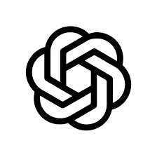
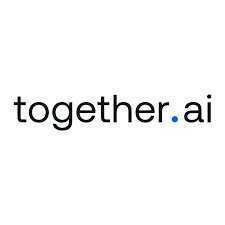

<p align="center">
  
</p>

<h1 align="center">🎙️ TapWisper Desktop</h1>

<p align="center">
  <strong>Open-source, system-wide voice dictation with AI.</strong><br/>
  Bring your own API key, or run open-source models offline on your computer — GPU-accelerated and fully private.<br/>
  Download, configure, and start using it in seconds.
</p>

<p align="center">
  <a href="https://tapwisper.ai">🌐 tapwisper.ai</a>
</p>

<p align="center">
  <a href="LICENSE"></a>
  
  <a href="https://www.electronjs.org/"></a>
  <a href="https://react.dev/"></a>
  <a href="https://github.com/sponsors/zeyadelosherey"></a>
</p>

<p align="center">
  &nbsp;&nbsp;
  &nbsp;&nbsp;
  &nbsp;&nbsp;
  &nbsp;&nbsp;
  
</p>

<p align="center">
  <em>Supports Google Gemini · OpenAI · Claude · Together AI · Soniox · Local models · Self-hosted</em>
</p>

---

## 🆕 What's New in v1.2.0

| | Feature | What it means for you |
|:-:|---------|-----------------------|
| 💻 | **Local models** | Dictation and AI run on your computer with open-source models: 18 speech models (Whisper, NVIDIA Parakeet, Qwen3-ASR, Voxtral) and 24 language models (Qwen, Gemma, Llama, Phi, Mistral, gpt-oss and more). No API key, no internet, nothing leaves your computer |
| 🚀 | **GPU acceleration** | Metal on Apple Silicon, Vulkan on Windows and Linux (NVIDIA, AMD, Intel Arc), with automatic fallback to the CPU |
| 🖧 | **Self-hosted servers** | Point TapWisper at your own Ollama, LM Studio, vLLM, LocalAI or speaches server |
| 🎯 | **Smart model picker** | Every model is rated for your computer's memory and GPU; downloads resume and are checked against their published checksum |
| 🌍 | **Works everywhere** | Model folders with non-English names (like `C:\Users\محمد`) work on Windows; the app explains clearly when a device can't run local models |

Choose an engine in **Settings → Speech-to-Text** and **Settings → Language Models**. Details: [docs/LOCAL_MODELS.md](docs/LOCAL_MODELS.md).

---

## 🎬 Demo

<p align="center">
  <a href="https://youtu.be/qNLpSK1ctOo">
    
  </a>
</p>

<p align="center">
  <a href="https://youtu.be/qNLpSK1ctOo">▶️ Watch the full demo on YouTube</a>
</p>

---

## 📥 Download

<p align="center">
  <a href="https://github.com/zeyadelosherey/tapwisper-desktop/releases/latest">
    
  </a>
</p>

| Platform | Download | Architecture |
|:--------:|:--------:|:------------:|
| 🍎 macOS | <a href="https://github.com/zeyadelosherey/tapwisper-desktop/releases/download/v1.2.0/tapwisper-desktop-1.2.0-arm64.dmg"></a> | Apple Silicon (M1/M2/M3/M4) |
| 🍎 macOS | <a href="https://github.com/zeyadelosherey/tapwisper-desktop/releases/download/v1.2.0/tapwisper-desktop-1.2.0-x64.dmg"></a> | Intel |
| 🪟 Windows | <a href="https://github.com/zeyadelosherey/tapwisper-desktop/releases/download/v1.2.0/tapwisper-desktop-1.2.0-setup.exe"></a> | x64 |

<p align="center">
  📦 Browse all versions on the <a href="https://github.com/zeyadelosherey/tapwisper-desktop/releases">Releases page</a>
</p>

---

## 🚀 Quick Start

1. **📥 Download** the installer for your platform from the table above
2. **⚙️ Open** the app and go to **Settings → Speech-to-Text** and **Language Models**
3. **🔑 Paste** your API key (Gemini, OpenAI, Claude, Together AI or Soniox) — or pick **Local** and download an open-source model, or point **Self-hosted** at your own server
4. **🎤 Start using it** — hold <kbd>fn</kbd> (Mac), <kbd>Ctrl</kbd>+<kbd>Win</kbd> (Windows) or <kbd>Right Ctrl</kbd> (Linux) and speak

> 💡 No account needed. No sign-up. Just your API key — or no key at all with local models.

---

## 🌍 Works Everywhere You Type

TapWisper runs system-wide — just speak and your text appears in **any app** on your computer. No plugins, no integrations, no setup per app.

| Category | Apps |
|:--------:|------|
| 💻 **Code Editors** | Cursor, Windsurf, VS Code, Xcode, JetBrains (IntelliJ, WebStorm, PyCharm), Neovim, Terminal |
| 💬 **Communication** | Slack, Discord, Microsoft Teams, Gmail, Outlook, Telegram, WhatsApp, iMessage |
| 📝 **Productivity** | Notion, Obsidian, Google Docs, Microsoft Word, Linear, Jira, Confluence |
| 🌐 **Browsers** | Chrome, Safari, Firefox, Arc, Edge, Brave — any website, any text field |
| 🤖 **AI & Dev Tools** | ChatGPT, Claude, Cursor Chat, GitHub, GitLab, any CLI or REPL |

...and literally **every other app** on macOS, Windows, and Linux. If you can type in it, TapWisper works in it.

> ⌨️ Hold **fn** (Mac), **Ctrl+Win** (Windows) or **Right Ctrl** (Linux), speak, let go — your words appear wherever your cursor is. It's that simple.

---

## 💡 Why TapWisper?

TapWisper is a **free, open-source** alternative to tools like [WhisperFlow](https://whisperflow.com) and [SuperWhisper](https://superwhisper.com). Unlike closed-source alternatives, TapWisper gives you full control:

| | Feature | Description |
|:-:|---------|-------------|
| 🔑 | **BYOAPI** | Bring Your Own API key — no subscriptions, no middleman |
| 🔓 | **100% Open Source** | Inspect, modify, and contribute. MIT licensed |
| 🛡️ | **Privacy First** | Audio & text go directly to your chosen provider — or never leave your computer with local models. Nothing passes through our servers |
| ✈️ | **Works Offline** | Local models run with no internet connection and no API key |
| 🖥️ | **Cross-Platform** | macOS, Windows, and Linux |

---

## ✨ Features

| | Feature | Description |
|:-:|---------|-------------|
| 🎤 | **Voice Dictation** | Push-to-talk or toggle recording from anywhere on your system |
| 🤖 | **AI Text Transformations** | Rewrite, summarize, translate, fix grammar, and more |
| 🔌 | **Multiple AI Providers** | Google Gemini, Together AI, OpenAI, Claude |
| 🗣️ | **Multiple Voice Providers** | Together Whisper, OpenAI Whisper / GPT-4o Transcribe, Soniox — any spoken language, auto-detected |
| 💻 | **Local & Self-hosted Models** | Run 18 speech models (Whisper, NVIDIA Parakeet, Qwen3-ASR, Voxtral) and 24 open language models (Qwen, Gemma, Llama, Phi, Mistral, SmolLM, Granite, gpt-oss and more) offline on your computer, or use your own Ollama / LM Studio / vLLM server — see [docs/LOCAL_MODELS.md](docs/LOCAL_MODELS.md) |
| 🚀 | **GPU Acceleration** | Local models use the GPU: Metal on Apple Silicon, Vulkan on Windows and Linux (NVIDIA, AMD, Intel Arc), with automatic CPU fallback. Each model is rated for your computer's memory and GPU |
| ⚡ | **Custom Actions** | Create your own AI action categories and prompts |
| 🎯 | **Voice Triggers** | Hands-free automation with voice commands (tolerant of small transcription errors) |
| 📋 | **Text Snippets** | Quick text expansion via trigger phrases |
| 📝 | **Voice Notes** | Record and transcribe notes |
| 🧩 | **Template Library** | 100 built-in prompt templates you can add to your actions |
| 🌐 | **Multi-Language** | English, Arabic, German, Spanish, French, Italian |
| 🌙 | **Dark Mode** | System, dark, and light theme support |
| ↔️ | **RTL Support** | Right-to-left layout for Arabic |

---

## ⌨️ Keyboard Shortcuts

| Shortcut | Action |
|:--------:|--------|
| Hold <kbd>fn</kbd> (Mac) · <kbd>Ctrl</kbd>+<kbd>Win</kbd> (Windows) · <kbd>Right Ctrl</kbd> (Linux) | Push-to-talk: speak while holding, release to paste |
| Add <kbd>Space</kbd> while holding | Hands-free: keeps listening after you let go; press the shortcut again to stop |
| Quick tap of the shortcut | Also hands-free (tap again to stop) |
| <kbd>Esc</kbd> | Cancel / dismiss any panel |

Change it in Settings → Shortcuts. On macOS, set *System Settings → Keyboard → “Press 🌐 key to”* to **Do Nothing** so fn doesn't also open the emoji picker. Macs without an fn key can use <kbd>Ctrl</kbd>+<kbd>Option</kbd>.

---

## 🛠️ Getting Started (Development)

### 📋 Prerequisites

- [Node.js](https://nodejs.org/) v18 or later
- npm v9 or later
- macOS 12+, Windows 10+, or Linux (X11; on Wayland, install `wtype` so text can be pasted)
- Optional, for local models in a development build: git, CMake 3.21+ and a C++17 compiler, then `npm run build:runtimes` (add `-- --vulkan` for the GPU backend on Windows/Linux; see [docs/LOCAL_MODELS.md](docs/LOCAL_MODELS.md#building-the-runtimes))

### 📦 Installation

```bash
# Clone the repository
git clone https://github.com/zeyadelosherey/tapwisper-desktop.git
cd tapwisper-desktop

# Install dependencies
npm install

# Run in development mode
npm run dev
```

### 🏗️ Build & Package

```bash
# Build for production
npm run build

# Package for your platform
npm run dist:mac     # macOS (DMG + ZIP)
npm run dist:win     # Windows (NSIS installer)
npm run dist:linux   # Linux (AppImage)
```

### 📜 Available Scripts

| Script | Description |
|--------|-------------|
| `npm run dev` | 🔄 Start the app in development mode with hot reload |
| `npm run build` | 📦 Build for production |
| `npm run dist` | 🚀 Build and package for distribution |
| `npm run typecheck` | ✅ Run TypeScript type checking |
| `npm run lint` | 🔍 Run ESLint |
| `npm test` | 🧪 Run the Vitest unit tests |
| `npm run format` | 💅 Format code with Prettier |
| `npm run build:runtimes` | 🧠 Build the bundled whisper.cpp / llama.cpp servers for local models ([details](docs/LOCAL_MODELS.md#building-the-runtimes)) |

---

## 🧰 Tech Stack

| Technology | Purpose |
|:----------:|---------|
| ⚛️ **React 19** | UI framework |
| ⚡ **Electron 33+** | Cross-platform desktop shell |
| 🎨 **Tailwind CSS** | Utility-first styling |
| 🏎️ **Vite** | Fast dev builds via electron-vite |
| 🔐 **electron-store** | Config storage (API keys encrypted with the OS keychain via `safeStorage`) |
| 🗄️ **better-sqlite3** | Activity database |
| 🐻 **Zustand** | State management |
| 🌍 **i18next** | 6-language localization |
| 🎬 **Framer Motion** | Smooth animations |
| 🧠 **whisper.cpp / llama.cpp** | On-device speech-to-text and language models (bundled, built from source) |

---

## 🤖 AI Providers

| Provider | Type | Description |
|:--------:|:----:|-------------|
|  **Google Gemini** | LLM | Fast, versatile language model |
|  **Together AI** | LLM + Voice | Language model and Whisper transcription |
|  **OpenAI** | LLM | GPT models for text processing |
|  **Claude** | LLM | Anthropic's Claude models |
|  **Soniox** | Voice | High-accuracy speech-to-text |
| 💻 **Local** | LLM + Voice | whisper.cpp and llama.cpp on your computer: 18 speech models and 24 open-source language models, downloaded once and verified, GPU-accelerated with Metal or Vulkan |
| 🖧 **Self-hosted** | LLM + Voice | Any OpenAI-compatible server on your network |

---

## 📁 Project Structure

```
src/
  main/            # ⚙️ Electron main process (tray, shortcuts, windows, IPC)
    local-ai/      #   🧠 Local inference servers, model downloads, self-hosted client
  preload/         # 🔒 Context bridge (secure API for renderer)
  shared/          # 🤝 Code shared by main and renderer (local model catalog, WAV encoder)
  renderer/        # 🎨 React frontend
    components/    #   🧩 Overlay UI (recording pill, pinned panel, command popup)
    pages/         #   📄 Settings window pages (home, settings, triggers, etc.)
    services/      #   🔌 AI API clients (Gemini, OpenAI, Claude, Together, Soniox)
    hooks/         #   🪝 React hooks (audio, shortcuts)
    store/         #   🗂️ Zustand state stores (stats, activity)
    models/        #   📐 TypeScript type definitions
    constants/     #   📌 Shared constants (colors, providers)
    utils/         #   🔧 Shared utility functions (formatting)
    i18n/          #   🌐 Translation files (en, ar, it, es, fr, de)
    assets/        #   🖼️ Static assets (logos, images)
    styles/        #   🎨 Global CSS and theme
    types/         #   📝 Global type declarations
```

---

## 🤖 AI Agent Guidelines

This project includes configuration files for AI coding assistants so they can understand the codebase:

| Tool | Config File | Description |
|:----:|-------------|-------------|
| [Cursor](https://cursor.com) | [`.cursor/rules/`](.cursor/rules/) | Project rules for Cursor AI |
|  [Claude Code](https://docs.anthropic.com/en/docs/claude-code) | [`CLAUDE.md`](CLAUDE.md) | Project context for Claude Code CLI |
|  [OpenAI Codex](https://openai.com/codex) | [`CODEX.md`](CODEX.md) | Project context for OpenAI Codex |
|  [GitHub Copilot](https://github.com/features/copilot) | [`.github/copilot-instructions.md`](.github/copilot-instructions.md) | Project context for Copilot |

---

## ❤️ Sponsor TapWisper

TapWisper is free and open source. If you find it useful, please consider supporting its development:

### 🙏 Individual Supporters

You can sponsor the project through GitHub Sponsors — every contribution helps keep the project maintained and growing:

<p align="center">
  <a href="https://github.com/sponsors/zeyadelosherey">
    
  </a>
</p>

### 🏢 Corporate Sponsorship

If your company uses TapWisper and would like to sponsor the project, partner on features, or discuss enterprise support, we'd love to hear from you:

- 📧 **Email**: [support@tapwisper.ai](mailto:support@tapwisper.ai)
- 💬 **GitHub Discussions**: [Start a conversation](https://github.com/zeyadelosherey/tapwisper-desktop/discussions)

> Corporate sponsors get visibility on this README and priority feature discussions.

---

## 🆘 Support

Have a question, found a bug, or want to request a feature?

- 📧 **Email**: [support@tapwisper.ai](mailto:support@tapwisper.ai)
- 🐛 **Issues**: [GitHub Issues](https://github.com/zeyadelosherey/tapwisper-desktop/issues)

## 🤝 Contributing

We welcome contributions! TapWisper is open source and community-driven. Please read our [Contributing Guide](CONTRIBUTING.md) to get started.

## 🔒 Security

For reporting security vulnerabilities, please see our [Security Policy](SECURITY.md).

## 📄 License

This project is licensed under the **MIT License** — see the [LICENSE](LICENSE) file for details.

## 🙌 Acknowledgements

Built with ❤️ using [Electron](https://www.electronjs.org/), [React](https://react.dev/), [Tailwind CSS](https://tailwindcss.com/), [Vite](https://vite.dev/), and many other great open-source projects.

Local models run on [whisper.cpp](https://github.com/ggml-org/whisper.cpp) and [llama.cpp](https://github.com/ggml-org/llama.cpp) by the ggml team, and download from [Hugging Face](https://huggingface.co). Thanks to the authors of the open models in the catalog (OpenAI Whisper, NVIDIA Parakeet and Nemotron, Qwen, Mistral and Voxtral, Google Gemma, Meta Llama, Microsoft Phi, Liquid AI, Hugging Face SmolLM, IBM Granite, OpenAI gpt-oss); each model's license is shown in the app before you download it.
